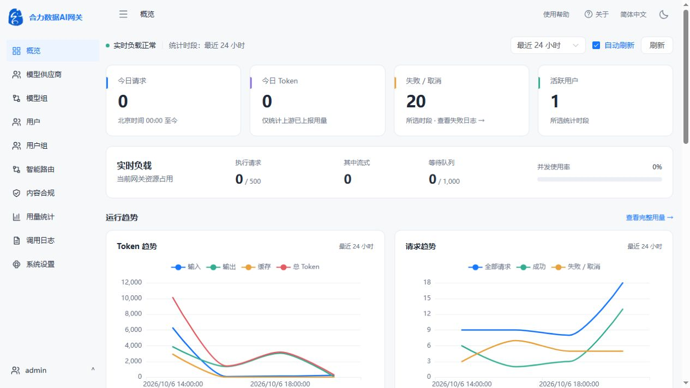
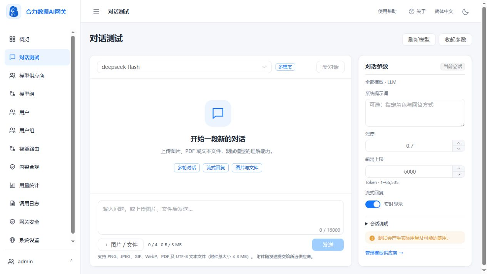
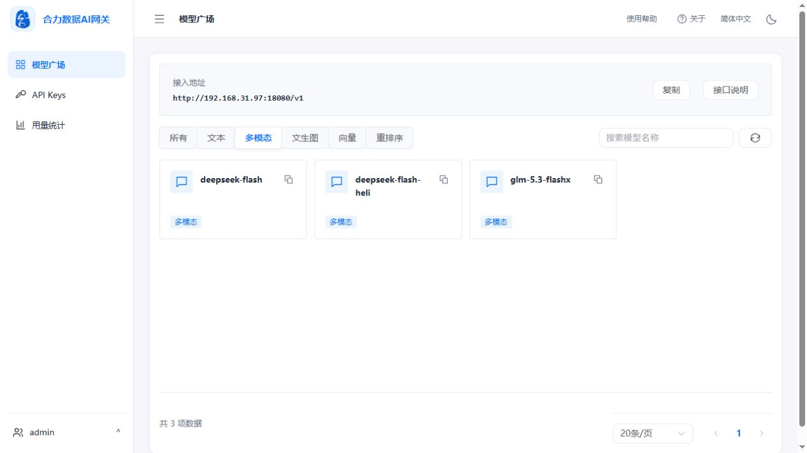
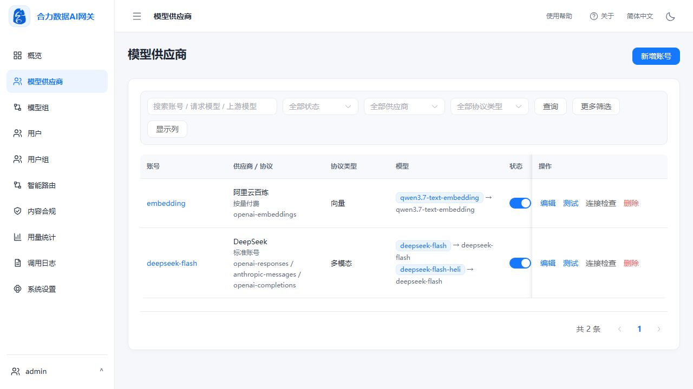
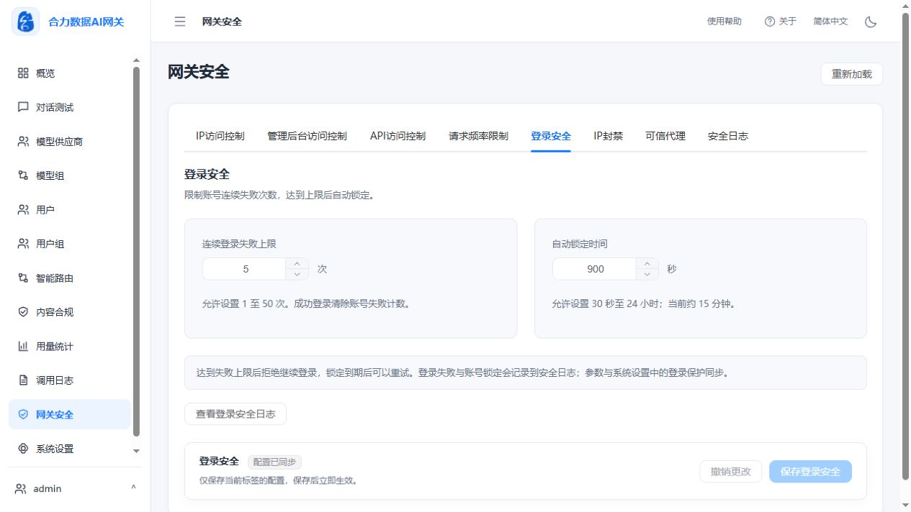
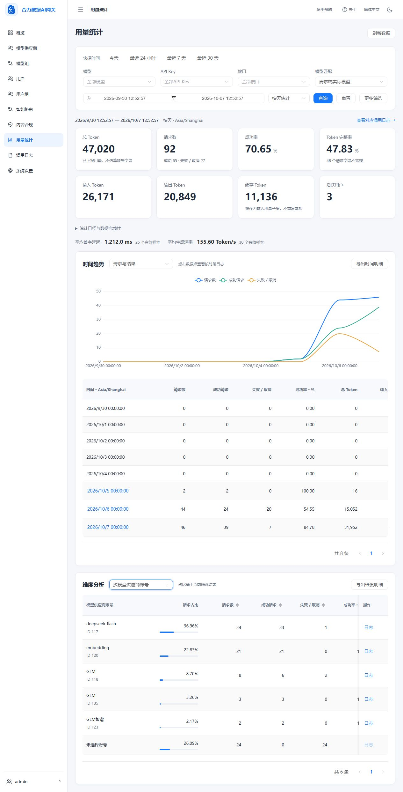
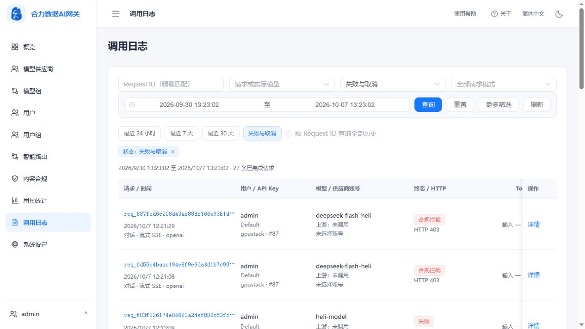
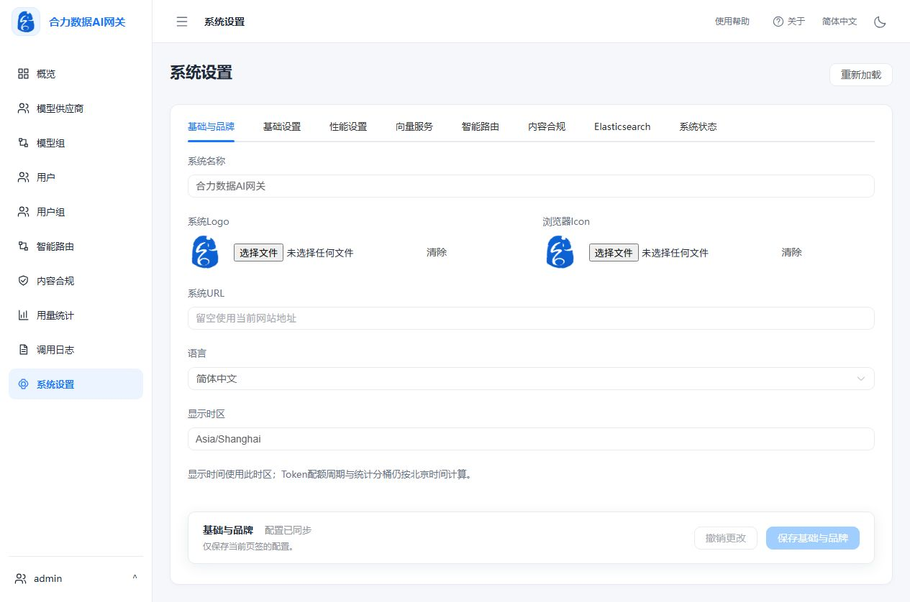

# 合力数据 AI 网关

合力数据 AI 网关（HeliData AI Gateway）用于集中管理模型供应商、模型授权、智能路由、内容合规和网关访问安全，并提供对话测试、用量分析与调用日志。

**当前版本：v1.0.8** · **数据库迁移：0032**

## 核心功能

| 模块 | 功能 |
| --- | --- |
| 概览 | 请求、Token、失败与取消、活跃用户、实时并发、趋势和排行 |
| 对话测试 | 模型选择、多轮对话、流式回复、停止生成、图片和文件附件、用量和审核记录 |
| 模型供应商 | 多供应商账号、多协议、完整 API 基础地址、模型映射、默认测试模型、连接检查、代理和并发管理 |
| 模型组 | 文本、多模态、文生图和向量模型分组、模型调度与故障切换 |
| 用户与用户组 | 角色管理、模型组授权、Token 配额、并发限制及个人 API Key |
| 智能路由 | 虚拟模型、样本管理、向量构建、简单与复杂任务分流、决策日志和统计 |
| 负载均衡路由 | 独立路由组、统一模型名称、五种调度策略、节点并发与健康恢复、故障切换及运行监控 |
| 内容合规 | 敏感词、正则和语义审核，模型及用户组策略、阻断与审计、审核日志 |
| 用量统计 | 时间与多维筛选、Token、成功率、首字耗时、生成速率、趋势和导出 |
| 调用日志 | 筛选与分页、请求链路、上游尝试、Token、耗时、错误与审核结果 |
| 网关安全 | IP、管理后台和 API 访问控制、API Key IP 绑定、限流、登录保护、IP 封禁、可信代理、安全日志 |
| 系统设置 | 品牌、运行参数、显示时区、向量服务、Elasticsearch、系统资源与组件状态、备份 |

提供 OpenAI Chat Completions、Responses、Anthropic Messages 等接口。对话、向量、重排、图像生成和多模态能力取决于上游模型、供应商与协议的实际支持。

## v1.0.8 更新

现有架构新增独立一级菜单“负载均衡路由”，复用供应商模型映射及原有授权、配额、限流和内容合规链路。配置、重试计费边界和升级注意事项见 [使用说明](docs/independent-balance-routes.md)，验证范围见 [检查报告](docs/independent-balance-validation-2026-10-18.md)。版本标签和生产部署需另行发布。

- 模型供应商补充默认地址、图标与套餐配置；普通供应商自动匹配协议，Custom OpenAI、vLLM、SGLang、Ollama 可手动选择协议。
- 自部署供应商可选择 `openai-completions`、`openai-responses`、`anthropic-messages`；仅选择上游实际支持的协议。普通供应商的独立协议地址由系统维护，表单不再重复展示。
- 优化对话测试的双栏布局、参数对齐、消息间距与附件显示；默认输出上限仍为 **5000 Token**，附件合计不超过 **3 MiB**。
- 修复用户模型广场将多模态误显示为文本的问题，新增独立的多模态筛选。
- 修复供应商批量测试交互及代理等待时间，防止更换供应商时误用原供应商凭据。
- 修复 SSE 将 `error: null` 误判为失败的问题，真实错误仍安全阻断且不泄露上游正文。

详细变更见 [v1.0.8 发布记录](docs/release-v1.0.8.md)，检查范围与遗留风险见 [代码安全审计](docs/code-audit-2026-10-15.md)。源码发布、生产部署和离线包分别管理，本次版本发布不代表生产容器或旧安装包已升级。

## 应用截图

截图位于 `pic/`，展示已部署页面；业务数据和实际配置以运行环境为准。

### 概览



### 对话测试



### 用户模型广场



### 模型供应商



### 网关安全



### 用量统计与调用日志





### 系统设置



## 技术架构

前端使用 Vue 3、TypeScript、Element Plus 和 ECharts，后端使用 FastAPI、SQLAlchemy 与 HTTPX。单容器由 Supervisor 管理 Nginx、Uvicorn、PostgreSQL 15 和 Redis；pgvector 提供向量检索，ONNX 本地模型提供语义审核。持久化数据挂载到 `/data`。

| 目录 | 内容 |
| --- | --- |
| `frontend/` | 管理后台与个人门户 |
| `backend/` | API、认证、网关流水线、供应商适配、数据库迁移和测试 |
| `docker/` | 镜像构建、Nginx、Supervisor 与容器入口 |
| `config/` | 配置模板 |
| `models/compliance/` | 本地审核模型资源与校验清单 |
| `scripts/` | 应用启停公共逻辑 |
| `offline/` | 离线部署脚本与部署包构建工具 |
| `docs/` | API、数据库、部署与发布文档 |
| `pic/` | 应用截图 |
| `releases/` | 本地生成的部署包和镜像，不随源码提交 |

## 构建与启动

目标环境为 Linux amd64，须安装 Docker Engine。建议至少 4 核 CPU、8 GiB 内存及 20 GiB 可用磁盘，并为数据、日志与备份预留空间。首次构建需要下载依赖和审核模型。

```bash
git clone https://github.com/leichuanxing/Helidata-AIGateway.git /opt/AIGateway
cd /opt/AIGateway
git checkout v1.0.8
python3 docker/fetch_compliance_model.py
docker build -f docker/Dockerfile -t helidata-ai-gateway:v1.0.8 .
./start.sh
curl -fsS http://127.0.0.1:18080/health
```

默认容器名为 `helidata-ai-gateway`，应用端口为 `18080`，数据目录为项目内的 `data/`。首次源码部署初始化 `admin` 并生成随机密码，密码仅写入 `/data/config/initial-admin-password.txt`（权限 600），不写入日志。服务器管理员可查看该文件，登录并修改密码后删除一次性文件。

```bash
docker exec -u root helidata-ai-gateway cat /data/config/initial-admin-password.txt
# 修改密码后删除一次性文件
docker exec -u root helidata-ai-gateway rm /data/config/initial-admin-password.txt
./stop.sh
./start.sh
```

`stop.sh` 保留容器与数据；`start.sh` 启动后等待健康检查。可通过 `APP_CONTAINER_NAME`、`APP_IMAGE`、`APP_PORT`、`APP_DATA_DIR` 自定义参数，启停使用相同配置。已有容器沿用原镜像，升级与回退按 [部署手册](docs/deployment.md) 执行。

## 离线部署

先构建对应版本的基础镜像，再制作离线镜像和安装包：

```bash
docker build -f docker/Dockerfile -t helidata-ai-gateway:v1.0.8 .
docker build -f offline/Dockerfile -t helidata-ai-gateway:v1.0.8-offline .
python3 offline/build_package.py --commit "$(git rev-parse HEAD)"
```

将 `releases/` 中的完整安装包复制到目标服务器：

```bash
tar -xzf helidata-ai-gateway-v1.0.8-linux-amd64-offline.tar.gz
cd helidata-ai-gateway-v1.0.8-linux-amd64
sudo ./deploy-offline.sh
```

安装器交互输入数据目录（默认 `/opt/AIGateway/data`）、管理员用户名（默认 `admin`）、两次密码和应用端口，启动后输出登录信息。密码隐藏输入，部署配置不保存明文密码。目标服务器须预装 Docker Engine、Bash、coreutils、findutils 和 util-linux，并使用新的空数据目录。

源码版本与旧离线产物独立：已有包仍保留原版本，v1.0.8 包须按上述命令重新构建。详见 [离线部署说明](offline/README.md)。

## 模型接入与 API

1. 配置模型供应商账号、实际支持的协议、完整 API 基础地址和凭据，建立模型映射。
2. 创建模型组，配置调度与故障切换。
3. 为用户组授权模型组，设置配额与并发。
4. 用户在个人门户创建 API Key，通过网关调用。

```bash
export GATEWAY_BASE=http://服务器IP:18080
export GATEWAY_KEY=你的网关APIKey
curl "$GATEWAY_BASE/v1/chat/completions" \
  -H "Authorization: Bearer $GATEWAY_KEY" \
  -H "Content-Type: application/json" \
  -d '{"model":"已授权的逻辑模型","messages":[{"role":"user","content":"你好"}],"stream":true}'
```

供应商凭据加密保存，个人 API Key 完整值仅在创建时显示一次。GLM、Qwen 等模型的推理字段跨协议转换仍有限制，优先使用原生 Chat；配置协议选项不能让上游获得其本身不支持的接口。更多接口见 [API 文档](docs/api.md)。

对话测试使用当前用户的模型权限、配额和合规策略，真实调用可能产生费用。多模态每次最多 4 个附件，合计不超过 3 MiB，支持 PNG、JPEG、GIF、WebP、PDF 和 UTF-8 文本；对话及附件仅保留在当前页面。内容合规不审核图片、音频、视频、PDF、媒体 URL 或文件名；文字匹配和语义审核按已配置策略执行。智能路由样本的上游向量构建也可能产生费用，按需显式执行。

## 网关安全

超级管理员可使用 IP访问控制、管理后台访问控制、API访问控制、请求频率限制、登录安全、IP封禁、可信代理、安全日志八个标签。

- 支持 IPv4、IPv6、单个 IP 和 CIDR 网段；后台来源限制默认关闭，访问登录页后仍需有效账号密码。
- API Key IP 绑定独立于 API 来源开关生效；IP 和 Key 的每分钟请求上限填 0 表示关闭。
- 临时封禁到期自动失效，支持永久封禁与解除封禁；规则优先于白名单。
- 仅指定可信代理可通过 `X-Forwarded-For` / `X-Real-IP` 传递来源地址，禁止信任全网。
- 保存白名单、封禁和可信代理配置时检查当前管理员 IP，防止误配置导致无法访问。
- 安全日志支持来源 IP、事件、时间筛选和详情，默认最近 7 天，单次范围不超过 31 天；不记录密码、完整 Key 或对话内容。

网络变化导致管理员无法访问时，服务器管理员可执行本机恢复。该操作清除访问规则、封禁、Key IP 绑定、可信代理与 RPM 限制，保留账号密码和登录保护，并记录恢复事件；重启后生效。

```bash
docker exec helidata-ai-gateway python -m app.services.gateway_security_recovery --confirm-reset-access
docker restart helidata-ai-gateway
```

## 运维与文档

```bash
docker exec helidata-ai-gateway supervisorctl status
curl -fsS http://127.0.0.1:18080/health/detail
docker exec helidata-ai-gateway alembic current
```

生产环境使用可信 HTTPS 入口，不对外开放 PostgreSQL 和 Redis 端口。备份包含数据库、配置、凭据解密 Master Key 和上传文件，应存放在受控位置；升级前备份，回退时恢复匹配的数据与配置。

- [当前状态](docs/current-status.md)
- [部署、备份与恢复](docs/deployment.md)
- [数据库设计](docs/database-design.md)
- [v1.0.8 发布记录](docs/release-v1.0.8.md)
- [许可证](LICENSE)

## 质量验证与边界

最近一次代码审计中，后端105项、前端22项、启停脚本14项及7个Shell语法检查通过；48个已安装Python包与npm依赖扫描未命中当时的已知漏洞。该结果不等于没有未知漏洞，亦不覆盖持续压力、生产灾难恢复和全部供应商能力。

生产应部署HTTPS；默认HTTP入口不能保护传输中的密码和API Key。供应商模型能力及价格以官方文档和实际账号配置为准。发布源码前后的验收记录、环境差异及未验证项见 `docs/`。
