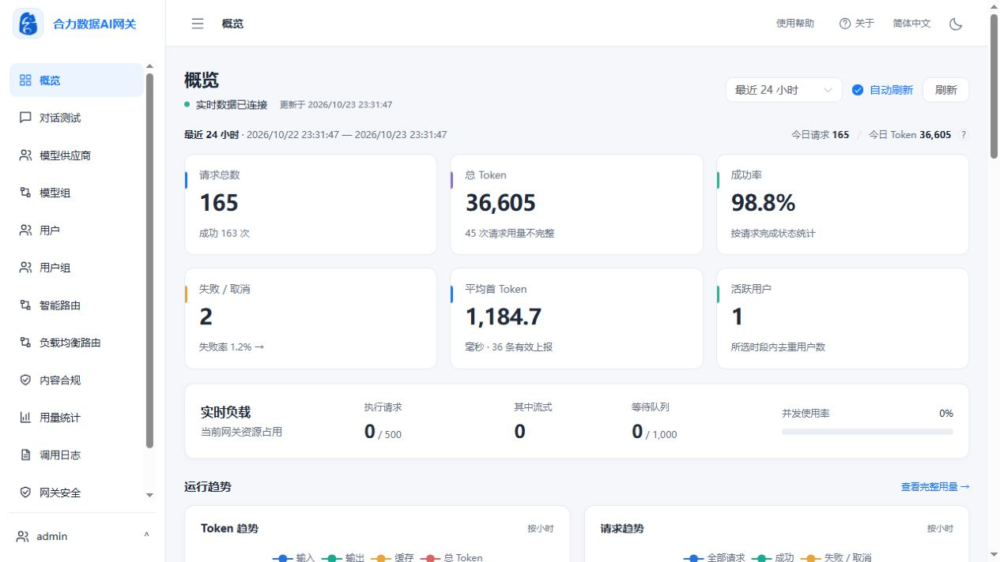
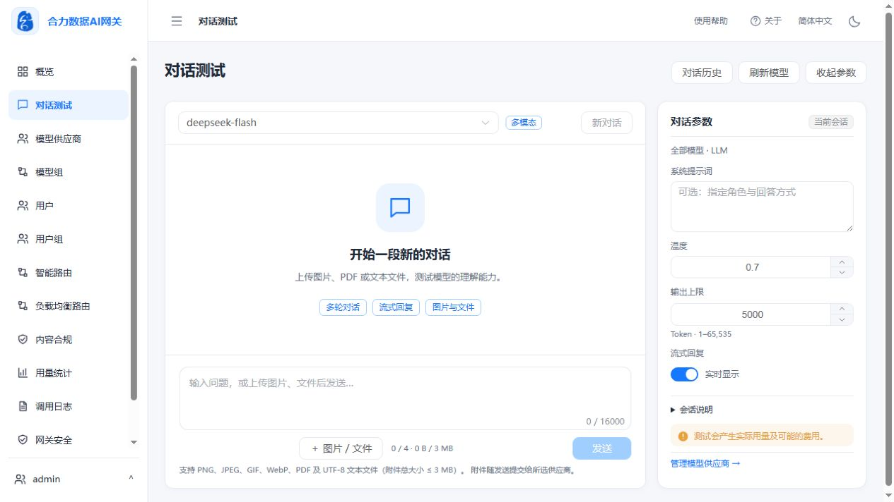
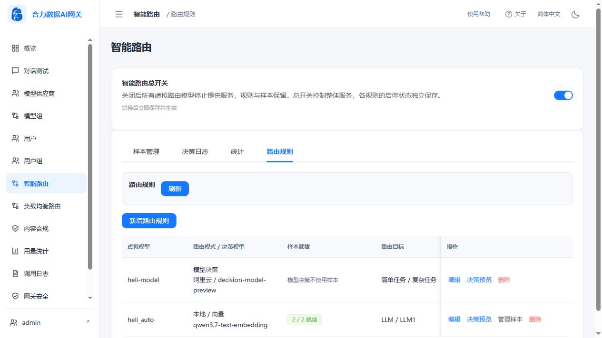
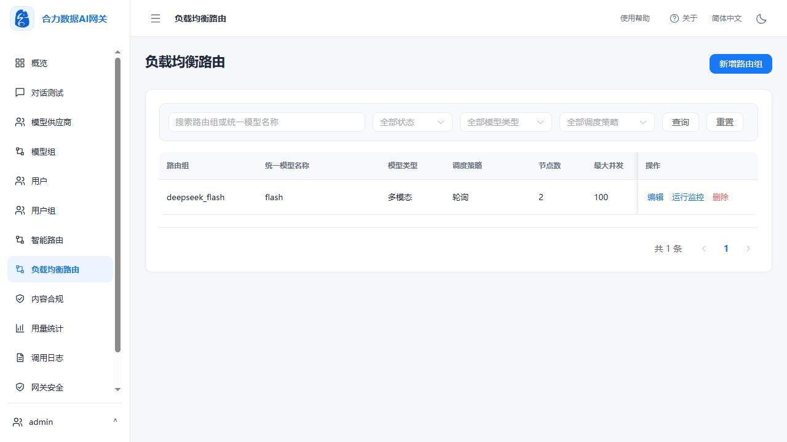
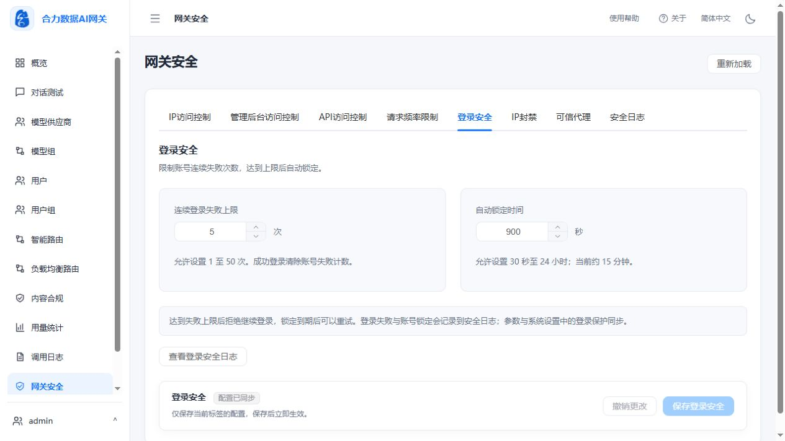
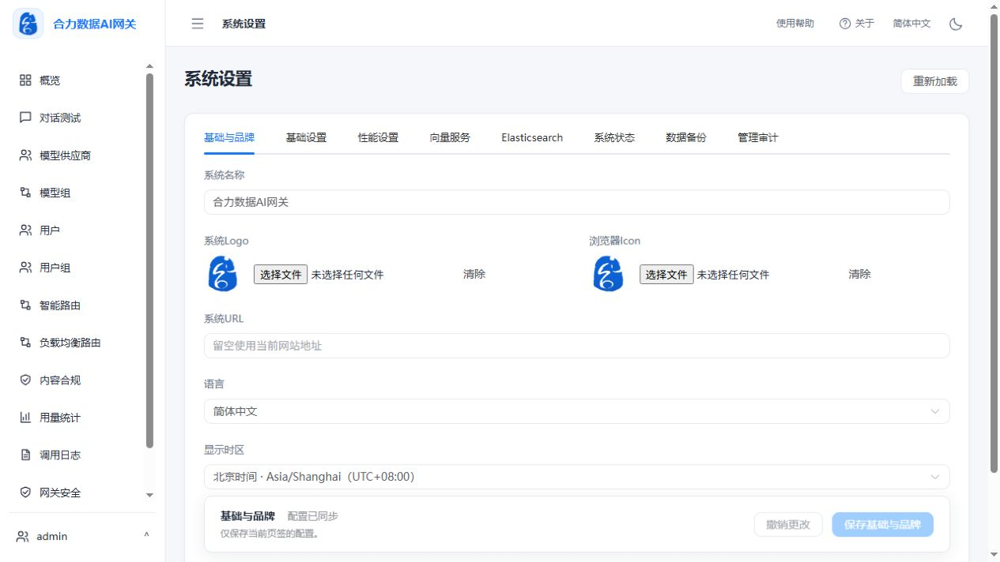

# 合力数据 AI 网关

合力数据 AI 网关（HeliData AI Gateway）统一接入模型供应商，为团队提供模型授权、智能路由、负载均衡、内容合规、访问安全及用量审计。管理后台与用户门户共用一套请求处理链路，可用于自部署模型与云端模型的集中管理。

**当前源码版本：v1.0.9** · **数据库迁移：0036** · [发布说明](docs/release-v1.0.9.md)

## v1.0.9 更新

- 智能路由支持**本地 / 向量**、**模型决策**两种模式；每条路由规则独立设置，复用已有模型组及授权。
- 模型决策接入 TypeSafe 与阿里云百炼，支持自定义阿里云决策服务地址、加密密钥、2–10 个目标、独立置信度阈值和兜底组，以及真实模型测试与决策预览。
- 优化规则列表、样本就绪提示、构建队列、版本冲突保护、历史证据、决策日志与统计，修复列表隐藏和自定义目标名称显示问题。
- 内容合规配置归入独立模块；系统设置保留品牌、运行参数、向量服务、系统状态、数据备份与管理审计。
- 整理设置加载与保存流程、用量及日志筛选、模型授权联动及启停脚本；离线工具同步版本和迁移检查。
- README 更新为当前功能说明，应用截图重新采集并保存在 `pic/`。

## 核心功能

| 模块 | 功能 |
| --- | --- |
| 概览 | 请求、Token、成功与失败、活跃用户、实时并发、运行趋势与排行 |
| 对话测试 | 多轮与流式对话、停止生成、图片和文件、文生图测试、测试历史、用量及合规记录 |
| 模型供应商 | 默认地址与图标、账号套餐、协议能力、模型发现及映射、连接与生成测试、代理、优先级与并发 |
| 模型组 | 模型分组、供应商调度、模型授权及故障切换 |
| 用户与用户组 | 管理角色、模型授权、Token 配额、并发限制及个人 API Key |
| 智能路由 | 虚拟模型、独立路由模式、样本构建、模型决策、预览、兜底、证据与统计 |
| 负载均衡路由 | 统一模型名、多节点、五种策略、健康恢复、重试、并发及运行监控 |
| 内容合规 | 敏感词、正则、语义样本、模型/用户组策略、阻断和审核日志 |
| 用量统计 | 时间、模型、用户等维度筛选，Token、请求状态、首字耗时、生成速率及导出 |
| 调用日志 | 请求链路、真实节点、重试、用量、耗时、错误、合规和路由信息 |
| 网关安全 | IP/CIDR、后台/API 来源限制、Key IP 绑定、限流、登录保护、封禁、可信代理及安全日志 |
| 系统设置 | 品牌、时区、性能、向量服务、Elasticsearch、系统状态、备份及管理审计 |

提供 Chat Completions、Responses、Anthropic Messages、向量、重排序及图像生成等接口。模型能力取决于供应商、账号、协议和实际模型，选择协议不会让上游获得其本身不支持的能力。

## 应用截图

以下截图于 **2026-10-23** 从实际运行页面重新采集，展示本次源码包含的界面；数据仅为当时状态，不代表所有部署环境。截图本身不表示 v1.0.9 镜像或离线包已经构建。

### 概览



### 对话测试



### 智能路由



### 负载均衡路由



### 网关安全



### 系统设置



## 技术架构

前端采用 Vue 3、TypeScript、Element Plus、ECharts；后端采用 FastAPI、SQLAlchemy、HTTPX、PostgreSQL、Redis。单容器由 Supervisor 管理 Nginx、Uvicorn、PostgreSQL 和 Redis；pgvector 提供向量检索，本地 ONNX 模型提供语义审核。持久化数据位于容器 `/data`。

| 目录 | 内容 |
| --- | --- |
| `frontend/` | 管理后台、用户门户与前端测试 |
| `backend/` | API、网关、适配器、迁移与后端测试 |
| `docker/` | 镜像、Nginx、Supervisor及入口脚本 |
| `config/` | 配置模板 |
| `models/compliance/` | 审核模型资源清单与说明 |
| `scripts/` | 应用启停与源码发布检查 |
| `offline/` | 离线镜像和安装包构建工具 |
| `docs/` | API、架构、部署与版本说明 |
| `pic/` | 应用截图 |
| `releases/` | 本地构建产物，不随源码提交 |

## 构建与启动

目标环境为 Linux amd64，需安装 Docker Engine。建议至少 4 核 CPU、8 GiB 内存和 20 GiB 可用磁盘，并为日志、数据及备份预留空间。首次构建需联网下载依赖和审核模型。

```bash
git clone https://github.com/leichuanxing/Helidata-AIGateway.git /opt/AIGateway
cd /opt/AIGateway
git checkout v1.0.9
python3 docker/fetch_compliance_model.py
docker build -f docker/Dockerfile -t helidata-ai-gateway:v1.0.9 .
./start.sh
curl -fsS http://127.0.0.1:18080/health
```

默认容器名为 `helidata-ai-gateway`、宿主机端口 `18080`、源码部署数据目录为项目内 `data/`。首次部署初始化 `admin` 并生成随机密码，密码仅写入容器 `/data/config/initial-admin-password.txt`，不写入日志。

```bash
docker exec -u root helidata-ai-gateway cat /data/config/initial-admin-password.txt
# 登录并修改密码后删除一次性文件
docker exec -u root helidata-ai-gateway rm /data/config/initial-admin-password.txt
./stop.sh
./start.sh
```

`stop.sh` 保留容器和数据；`start.sh` 等待健康检查。可用 `APP_CONTAINER_NAME`、`APP_IMAGE`、`APP_PORT`、`APP_DATA_DIR` 自定义参数。已有容器沿用其镜像，切换源码版本不会自动更新运行容器；升级及回退见[部署手册](docs/deployment.md)。

## 离线部署

本仓库提供构建工具；**源码发布不等于已生成离线镜像或安装包**。应从版本标签构建，不能重命名旧包作为新版本。

```bash
docker build -f docker/Dockerfile -t helidata-ai-gateway:v1.0.9 .
docker build -f offline/Dockerfile -t helidata-ai-gateway:v1.0.9-offline .
python3 offline/build_package.py --commit "$(git rev-parse HEAD)"
```

将生成的安装包复制到已预装 Docker Engine 的 Linux amd64 主机：

```bash
tar -xzf helidata-ai-gateway-v1.0.9-linux-amd64-offline.tar.gz
cd helidata-ai-gateway-v1.0.9-linux-amd64
sudo ./deploy-offline.sh
```

安装器交互输入数据目录（默认 `/opt/AIGateway/data`）、管理员用户名（默认 `admin`）、两次密码和应用端口，启动后显示登录信息。密码隐藏输入，配置文件不保留明文密码。首次部署使用新的空数据目录；更多要求见[离线部署说明](offline/README.md)。

## 模型接入与调用

1. 添加供应商账号，核对实际支持的协议、基础地址、密钥和模型映射。
2. 创建模型组，配置调度及故障切换。
3. 为用户组授权模型组，设置配额与并发。
4. 用户在个人门户创建 API Key，使用网关统一地址调用。

```bash
export GATEWAY_BASE=http://服务器IP:18080
export GATEWAY_KEY=你的网关APIKey
curl "$GATEWAY_BASE/v1/chat/completions" \
  -H "Authorization: Bearer $GATEWAY_KEY" \
  -H "Content-Type: application/json" \
  -d '{"model":"已授权的模型名称","messages":[{"role":"user","content":"你好"}],"stream":true}'
```

普通供应商自动匹配协议；Custom OpenAI、vLLM、SGLang、Ollama等自部署账号可选择实际支持的协议。重排和图像生成需配置专用模型，支持范围以适配器与上游实际能力为准。供应商凭据加密保存，个人 API Key 完整值仅在创建时显示一次。接口细节见[API文档](docs/api.md)。

## 智能路由

总开关控制整体服务，每条规则独立选择本地/向量或模型决策。两种模式切换保留另一模式参数；目标组必须启用、存在兼容协议的真实模型且不能递归引用虚拟模型。

- **本地/向量**：有效就绪样本原文精确匹配不调用向量服务；其余请求使用Embedding与相似度分类。未构建或过期向量不参与匹配。无样本、相似度或分类置信差不足时转简单组；向量服务异常按失败策略处理。
- **模型决策**：将用户文本和配置的目标说明发送给决策服务，在2–10个目标间选择。选择其他、置信度不足或服务异常时转兜底组；权限、合规、配额与并发拒绝不会被兜底绕过。
- **测试与记录**：支持模型可用性测试、决策预览、真实请求日志、证据快照及统计。预览与真实请求分开计数，决策/向量子调用独立记录用量。

模型分类并非准确率保证，也不代替权限或安全边界。需要具有代表性的样本和互斥的目标说明。简单组与复杂组若指向同一底层模型，不会产生能力或成本分层。详见[智能路由说明](docs/smart-routing.md)。

## 对话、合规与访问安全

对话测试默认输出上限 **5000 Token**，可设置至 **65535**；多模态每次最多4个附件，合计不超过 **3 MiB**，支持图片、PDF和UTF-8文本。历史记录仅对当前管理员可见；附件记录与生成图片保留方式以页面说明为准，不应将其作为永久文件存储。

内容合规与实际请求链路一致，检查文字部分，不对图片、媒体URL或文件名进行文字审核。智能路由总开关位于智能路由页面；内容合规开关与参数在内容合规功能配置中管理。向量构建、预览、模型测试和生成均可能产生费用。

网关安全提供IP/CIDR、管理后台与API来源限制、Key IP绑定、RPM、登录保护、IP封禁、可信代理及安全日志。后台来源限制默认关闭，登录仍需有效账号密码。启用白名单会检查当前管理员IP；仅将实际代理服务器设为可信代理。

## 运维与升级

```bash
docker exec helidata-ai-gateway supervisorctl status
curl -fsS http://127.0.0.1:18080/health/detail
docker exec helidata-ai-gateway alembic current
```

升级前备份数据库、配置、Master Key和上传数据，回退时使用匹配版本的数据及配置。Master Key丢失会导致已加密凭据无法解密。生产应使用可信HTTPS入口，不对外暴露PostgreSQL和Redis端口。

本版包含0035模型决策字段及0036决策服务地址迁移。升级已有实例由迁移完成结构更新，不会自动填入决策密钥、替换模型或构建样本。

## 验证与边界

2026-10-23隔离回归共179项，177项通过、2项按运行条件跳过；独立模式专项另行通过。前端57项、类型检查与生产构建通过。真实调用验证了当前配置的模型决策、Embedding及三种生成协议的JSON/SSE链路，具体结果不能外推到所有供应商、所有输入或长期压力场景。

本版未承诺所有模型分类准确，也未覆盖生产破坏性故障注入、全部外部供应商或长期压力测试。用量测试阶段仍记录到待定位的asyncio transport告警。Token未上报不估算为0，统计口径以页面说明为准。发布源码、生产部署和离线产物分别管理。

- [v1.0.9发布说明](docs/release-v1.0.9.md)
- [当前源码状态](docs/current-status.md)
- [部署、备份和恢复](docs/deployment.md)
- [数据库设计](docs/database-design.md)
- [许可证](LICENSE)
